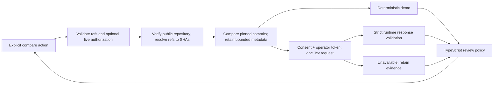

# Architecture

## Phase 1 runtime flow

```text
React/Vite client
  └─ /api/analyze, /api/source, /api/health, /api/change-impact ──> Vercel rewrites ──> api/router.ts
                                                     ├─ validate and dispatch
                                                     ├─ GitHub REST metadata/branch/tree
                                                     └─ bounded blobs ─> deterministic analyzer

Normalized analysis response ──> React Flow graph, file explorer, evidence panel
```

The browser never supplies a fetch URL to the server. Server GitHub requests use a fixed `https://api.github.com` origin. Every analysis resolves a branch once and uses the resulting commit SHA for tree and blob reads. The client stores the result only in page state. The source endpoint verifies that the requested path is a supported blob in the requested commit tree before returning it.

## Code boundaries

- `src/lib/validation` and `src/lib/graph`: browser-safe shared contracts and graph transformations.
- `src/features/analysis`: request lifecycle state and selection context.
- `src/components`: repository controls, explorer, graph, and evidence views.
- `lib/server/github`: fixed-origin GitHub access, timeout handling, and bounded concurrency.
- `lib/server/analysis`: language adapter and normalized graph construction, independent of HTTP/UI.
- `api/router.ts`: one Vercel Node.js Web Handler dispatches four fixed API routes. `vercel.json` rewrites preserve the public route URLs and send a validated route key to the shared entry point.
- `lib/server/routes`: isolated request handlers shared by Vercel and Vite.
- Vite development and preview middleware dispatch the same handlers locally, so local analysis does not require Vercel CLI or credentials.

## Graph semantics

Nodes represent project, directory/module, source file, and external package records. `contains` means a path is nested under a directory. `imports` edges record the source path, line, original module specifier, and whether the target was resolved. `references-package` edges identify an external package specifier. Static imports are evidence; the analyzer does not infer function calls or runtime execution.

The TypeScript compiler API is used only to parse source syntax and discover import/export declarations. Repository code is never loaded or executed. A language-adapter boundary keeps parser selection separate from graph normalization.

## Resource budgets

The Phase 1 defaults live in `lib/server/security/budgets.ts`: at most 2,500 eligible tree entries, 180 parsed source files, 80 KiB per source blob, 1 MiB total downloaded source/config text, eight concurrent blob requests, a 25-second analysis deadline, 500 graph nodes, 1,200 edges, 2,000 evidence items, and a 3.6 MB analysis response. A GitHub request has an 8-second timeout and at most one retry for transient transport or 5xx failures. Source preview is capped at 96 KiB. The values are deliberately conservative for an anonymous, synchronous serverless endpoint and are not promises about plan capacity. Any cap or API truncation marks the result partial.

## Change Impact Intelligence



`changeAnalysis.ts` fetches real GitHub comparison metadata with a 14-second overall GitHub deadline. It excludes generated artifacts, lockfiles and credential files, retains at most 60 filename/status/addition/deletion records, and adds path heuristics. The GitHub comparison response is capped at 3 MiB. GitHub may return patches in that response; the application discards them. No source, patch, commit message, issue text or README content enters the Jev state. This feature does not run the graph analyzer again or measure transitive impact. Its input is deliberately less expressive than a semantic diff.

`lib/server/jev` owns the official SDK adapter, batched Choice/Score/Noul questions, deterministic demo and review policy. `src/lib/validation/changeImpact.ts` contains browser-safe Zod schemas and labels. The UI calls the same API for demo and live modes, and visibly identifies their provenance. Failure yields `mode: unavailable`, `decision: null`, retained facts, a safe error code and a conservative review recommendation.

The application has no user-account system. Public visibility is the repository authorization boundary. Live inference additionally requires a server-configured operator bearer token and explicit metadata-sharing consent. The token is entered as a password, retained only in component memory, and sent only on explicit live requests. It is never a frontend environment variable.

The decision cache stores at most 32 results for five minutes per warm function instance. Its SHA-256 identity includes normalized facts, refs and SHAs, question/policy versions, model, mode and operator digest. Concurrent identical live requests share one promise. Public demo cache entries cannot be reused as live decisions. Cache hits still recheck repository visibility and resolve refs. There is no cross-user private data because private repositories are rejected before comparison. Cold starts discard the cache and instance limiter; neither is a distributed billing cap.

See [Jev contract and operation](jev-integration.md), [security controls](SECURITY.md), and [evaluation](evaluation.md).
